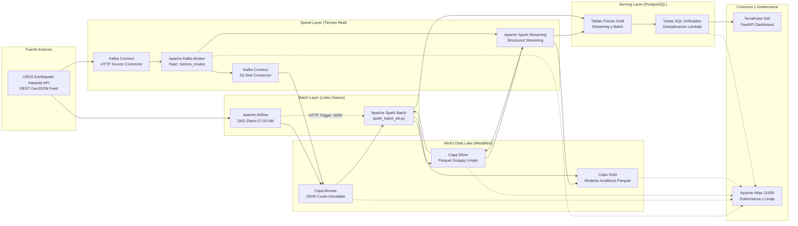

# Sistema Distribuido de Monitoreo Sísmico Global

Plataforma de Big Data para monitoreo y análisis geofísico en tiempo real e histórico, implementada bajo una **Arquitectura Lambda** integrada con un **Data Lake Medallion (Bronze, Silver, Gold)** sobre MinIO, Apache Kafka, Apache Spark, Apache Airflow, PostgreSQL, Apache Atlas y una interfaz GIS interactiva en FastAPI.

---

## 1. Resumen Ejecutivo del Proyecto

El sistema captura, limpia, procesa, agrega y cataloga eventos sísmicos a escala global reportados por el Servicio Geológico de los Estados Unidos (USGS Earthquake Hazards Program). La arquitectura desacopla el flujo en dos carriles de cómputo paralelos:

* **Carril de Tiempo Real (Speed Layer):** Ingesta continua segundo a segundo mediante Kafka y Spark Structured Streaming, reduciendo la latencia de detección y alerta a milisegundos.
* **Carril por Lotes (Batch Layer):** Extracción programada diaria mediante Apache Airflow y procesamiento masivo en Apache Spark Batch, garantizando la reconciliación y completitud histórica de los datos.
* **Serving Layer (PostgreSQL):** Vistas SQL unificadas que combinan en milisegundos la visión histórica consolidada con los eventos en vivo, resolviendo la deduplicación sin sobrecostos de lectura.
* **Gobernanza de Datos (Apache Atlas):** Catálogo centralizado de metadatos, clasificación de seguridad y trazabilidad del linaje de datos de extremo a extremo.

---

## 2. Diagrama de Arquitectura de Alto Nivel



---

## 3. Topología Distribuida del Clúster

La infraestructura se encuentra distribuida en 4 nodos de cómputo interconectados a través de una red local dedicada:

| Nodo / Responsable | Sistema Operativo | Servicios Desplegados | Puertos de Red |
| :--- | :--- | :--- | :--- |
| **Josué** | Linux | Apache Kafka Broker, Kafka Connect, Kafdrop UI | `9092` (Kafka), `8083` (Connect REST), `9009` (Kafdrop) |
| **Sayder** | Linux (4 GB RAM) | MinIO S3 Object Storage, PostgreSQL Serving Layer | `9000` (MinIO S3), `9001` (MinIO Console), `5432` (PostgreSQL) |
| **Jesús** | Windows | Apache Spark Master, Spark Worker 1, Trigger Server, Apache Airflow | `8080` (Spark UI), `7077` (Cluster), `5050` (Trigger API), `8085` (Airflow) |
| **Jhonatan** | Windows (Tech Lead) | Apache Atlas Data Governance, Servidor Web TerraPulse GIS | `21000` (Atlas UI & REST v2), `8000` (FastAPI / Dashboard) |

---

## 4. Especificación del Data Lake Medallion (MinIO)

El Data Lake se organiza en 3 niveles progresivos de refinamiento, implementados sobre buckets S3 en MinIO:

### A. Capa Bronze (Datos Crudos e Inmutables)
Almacena el payload GeoJSON original sin transformaciones ni pérdida de precisión.

* **Carril Streaming:** `s3a://bronze/streaming/año=YYYY/mes=MM/dia=DD/*.json`
  * Generado 24/7 por Kafka Connect S3 Sink con particionamiento temporal automático.
* **Carril Batch:** `s3a://bronze/batch/año=YYYY/mes=MM/dia=DD/sismos_batch_YYYY-MM-DD.json`
  * Descargado diariamente a las 07:00 AM UTC por el DAG programado en Apache Airflow.

### B. Capa Silver (Datos Limpios y Tipados: `fact_sismos`)
Estructura tabular aplanada, tipada estrictamente y deduplicada por `id_evento`. Formato Parquet con compresión Snappy particionado por `fecha_evento`.

* **Rutas en MinIO:**
  * Streaming: `s3a://silver/streaming/fecha_evento=YYYY-MM-DD/*.parquet`
  * Batch: `s3a://silver/batch/fecha_evento=YYYY-MM-DD/*.parquet`

| Columna | Tipo Spark | Tipo SQL | Descripción / Regla |
| :--- | :--- | :--- | :--- |
| `id_evento` | `StringType` | `VARCHAR(50)` | Identificador alfanumérico único del sismo emitido por USGS (PK). |
| `fecha_hora_utc` | `TimestampType` | `TIMESTAMP` | Timestamp exacto en UTC (`properties.time / 1000`). |
| `fecha_evento` | `DateType` | `DATE` | Fecha del sismo (Columna de partición física). |
| `hora_evento` | `IntegerType` | `INT` | Hora del evento (0 a 23) para análisis de estacionalidad horaria. |
| `magnitud` | `DecimalType(4,2)` | `NUMERIC(4,2)` | Magnitud en escala Richter/Momento (`properties.mag`). Null imputado a `0.0`. |
| `clasificacion_intensidad` | `StringType` | `VARCHAR(20)` | Regla de negocio: `<3.0` Menor, `3.0-4.9` Ligero, `5.0-6.9` Moderado/Fuerte, `≥7.0` Catastrófico. |
| `profundidad_km` | `DecimalType(8,2)` | `NUMERIC(8,2)` | Profundidad del hipocentro (`coordinates[2]`). |
| `significancia` | `IntegerType` | `INT` | Índice de impacto poblacional y mediático (`properties.sig`, 0 a 1000). |
| `alerta_tsunami` | `BooleanType` | `BOOLEAN` | `true` si `properties.tsunami == 1`, de lo contrario `false`. |
| `latitud` | `DecimalType(9,6)` | `NUMERIC(9,6)` | Latitud geográfica del epicentro (`coordinates[1]`). |
| `longitud` | `DecimalType(9,6)` | `NUMERIC(9,6)` | Longitud geográfica del epicentro (`coordinates[0]`). |
| `pais_estado` | `StringType` | `VARCHAR(100)` | País o estado geográfico normalizado (`element_at(split(place, ','), -1)`). |
| `ubicacion_completa` | `StringType` | `TEXT` | Descripción completa original (`properties.place`). |
| `origen_pipeline` | `StringType` | `VARCHAR(10)` | Trazabilidad del carril generador: `'STREAMING'` o `'BATCH'`. |

### C. Capa Gold (Modelos Analíticos y Agregaciones)
Data marts optimizados para respuestas analíticas en subsegundos:

* **Modelo Gold 1: Resumen Diario por País (`resumen_diario_pais`)**
  * Rutas: `s3a://gold/streaming/resumen_diario_pais/` y `s3a://gold/batch/resumen_diario_pais/`
  * Métricas: `total_sismos`, `magnitud_maxima`, `magnitud_promedio`, `profundidad_promedio_km`, `total_alertas_tsunami`, `sismos_peligrosos_m5`, agrupados por `(fecha_evento, pais_estado)`.
* **Modelo Gold 2: Zonas Críticas y Hotspots Sísmicos (`zonas_criticas_frecuentes`)**
  * Rutas: `s3a://gold/streaming/zonas_criticas_frecuentes/` y `s3a://gold/batch/zonas_criticas_frecuentes/`
  * Agrupación geoespacial por cuadrículas de $0.1^\circ \times 0.1^\circ$ ($\approx 10\text{ km}^2$) con clasificación de riesgo sísmico (`CRITICO`, `MODERADO`, `NORMAL`).

---

## 5. Serving Layer (PostgreSQL) y Deduplicación Lambda

Para garantizar disponibilidad y rendimiento, PostgreSQL solo aloja la capa Gold de consumo. La deduplicación se resuelve a nivel de base de datos mediante vistas SQL indexadas:

```
                  POSTGRESQL SERVING LAYER
┌──────────────────────────────┐   ┌──────────────────────────────┐
│    gold_resumen_batch        │   │    gold_resumen_streaming    │
│  (Carga Diaria Consolidada)  │   │     (Micro-lotes en Vivo)    │
└──────────────┬───────────────┘   └──────────────┬───────────────┘
               │                                  │
               └───────────────┬──────────────────┘
                               ▼
            ┌────────────────────────────────────┐
            │     vista_resumen_diario_pais      │
            │  (Deduplicacion en Milisegundos)   │
            └────────────────────────────────────┘
```

### Tablas Físicas Receptoras
1. `gold_resumen_batch` y `gold_resumen_streaming`: Clave primaria `(fecha_evento, pais_estado)`.
2. `gold_zonas_batch` y `gold_zonas_streaming`: Clave primaria `(cuadricula_lat, cuadricula_lon)`.

### Vistas SQL Unificadas de Consumo
* **`vista_resumen_diario_pais`:** Combina los datos de batch históricos con la telemetría en vivo mediante un `UNION ALL` filtrado con `NOT EXISTS`, asignando la etiqueta de auditoría `origen_dato` (`'BATCH'` o `'STREAMING'`).
* **`vista_zonas_criticas_frecuentes`:** Unifica la matriz de fallas mediante un `FULL OUTER JOIN` ponderado entre batch y streaming, recalculando el nivel de alerta dinámicamente en tiempo de consulta.

---

## 6. Gobernanza de Datos y Linaje (Apache Atlas)

La trazabilidad del dato se supervisa de manera centralizada en Apache Atlas en el puerto `21000`:

* **Etiquetas de Gobernanza (Clasificaciones):**
  * `MEDALLION_BRONZE`: Datos crudos en ingesta.
  * `MEDALLION_SILVER`: Datos limpios, normalizados y particionados.
  * `MEDALLION_GOLD`: Modelos analíticos y agregaciones de negocio.
  * `CRITICO_M5`: Eventos sísmicos de alta energía ($\ge 5.0\text{ Mw}$).
  * `ALERTA_TSUNAMI`: Eventos costeros con potencial de perturbación marina.
* **Linaje de Procesos Registrado:**
  `USGS API` $\rightarrow$ `Kafka Connect Source` $\rightarrow$ `Topic Kafka sismos_crudos` $\rightarrow$ `Kafka Connect S3 Sink` $\rightarrow$ `MinIO Bronze` $\rightarrow$ `Spark Streaming & Batch` $\rightarrow$ `MinIO Silver` $\rightarrow$ `MinIO Gold` $\rightarrow$ `PostgreSQL Serving Layer` $\rightarrow$ `TerraPulse GIS Web Dashboard`.

---

## 7. Centro de Mando Táctico: TerraPulse GIS

La capa de visualización e interacción se encuentra desarrollada en **FastAPI** y servida en `http://localhost:8000`:

* **Visualización Geoespacial en Vivo:** Mapa interactivo con Leaflet táctico, marcadores proporcionales a la magnitud y ondas de choque animadas en tiempo real.
* **Conmutador de Capas Cartográficas 100% Libres:** 4 mapas base sin dependencias de API keys (ESRI Gris Táctico, Océanos GIS, Satelital de Alta Resolución y OpenStreetMap).
* **Capa Tectónica Global:** Superposición GeoJSON de placas y fallas tectónicas (Subducción en fucsia, Transformantes en naranja, Divergentes en esmeralda).
* **Consola de Auditoría Lambda:** Modal de inspección de la capa Serving que audita en vivo la deduplicación con distintivos visuales `[STREAMING]` y `[BATCH]`.
* **Filtros Interactivos de Magnitud:** Chips tácticos en la leyenda (`Todas`, `<4.0`, `4.0-4.9`, `5.0-5.9`, `≥6.0`) para filtrado instantáneo en mapa y lista.
* **Sistema de Alerta Sísmica Temprana:** Notificación superior de emergencia y animación perimetral de pantalla ante sismos mayores ($\ge 6.0\text{ Mw}$).
* **Analítica Gold (Chart.js):** Métricas analíticas con gráficos de barras (Top regiones sísmicas) y gráficos de dona (Distribución por nivel de severidad).
* **Exportación CSV en 1 Clic:** Descarga instantánea de reportes tabulares codificados en UTF-8 BOM para compatibilidad con Microsoft Excel.
* **GeoIA Consultor:** Asistente conversacional con técnica RAG (Retrieval-Augmented Generation) potenciado por Google Gemini sobre PostgreSQL.

---

## 8. Guía Operativa de Despliegue Paso a Paso

### Paso 1: Nodo de Almacenamiento y Base de Datos (Sayder - Linux)
```bash
# 1. Iniciar MinIO Object Storage y PostgreSQL Serving Layer
cd infraestructura/minIO && docker compose up -d
cd ../postgres && docker compose up -d

# 2. Verificar estado de los servicios
docker ps
```

### Paso 2: Nodo de Ingesta Streaming (Josué - Linux)
```bash
# 1. Iniciar Apache Kafka, Kafka Connect y Kafdrop
cd infraestructura/kafka
docker compose up -d

# 2. Verificar en Kafdrop que el topic 'sismos_crudos' esté recibiendo mensajes
# URL: http://localhost:9009
```

### Paso 3: Nodo de Procesamiento y Orquestación (Jesús - Windows)
```powershell
# 1. Iniciar Clúster Spark (Master + Worker + Trigger Server)
cd infraestructura\spark
docker compose up -d

# 2. Iniciar Apache Airflow
cd ..\airflow
docker compose up -d

# 3. Acceder a las interfaces de monitoreo:
# Spark Master UI: http://localhost:8080
# Airflow UI: http://localhost:8085
```

### Paso 4: Nodo de Gobernanza y Aplicación Web (Jhonatan - Windows)
```powershell
# 1. Iniciar Apache Atlas
cd infraestructura\gobernanza
docker compose up -d

# 2. Una vez levantado el puerto 21000 (aprox. 2 minutos), inicializar el linaje
py inicializar_atlas.py

# 3. Iniciar el Servidor Web TerraPulse GIS
cd ..\..\web
py app.py

# 4. Acceder al Centro de Monitoreo:
# Dashboard Web: http://localhost:8000
# Apache Atlas UI: http://localhost:21000 (Credenciales: admin / admin)
```

---

## 9. Estructura del Repositorio

```text
Proyecto_sismos/
├── data/                               <- Muestras GeoJSON de prueba (offline fallback)
│   ├── sample_streaming_hora.json      <- Ventana de 1 hora para pruebas de Speed Layer
│   └── sample_batch_dia.json           <- Ventana de 24 horas para pruebas de Batch Layer
├── docs/                               <- Especificaciones de arquitectura
│   └── especificacion_tablas_medallion.md <- Diccionario de datos canónico
├── infraestructura/
│   ├── kafka/                          <- Broker Kafka KRaft, conectores y Kafdrop UI
│   │   ├── connectors/                 <- Configuraciones JSON de HTTP Source y S3 Sink
│   │   └── docker-compose.yml
│   ├── minIO/                          <- Object Storage S3 y creador automático de buckets
│   │   └── docker-compose.yml
│   ├── spark/                          <- Clúster PySpark 3.5.0, streaming job y batch ETL
│   │   ├── apps/
│   │   │   ├── spark_streaming_job.py  <- Structured Streaming continuo
│   │   │   ├── spark_batch_etl.py      <- Pipeline Batch diario
│   │   │   ├── spark_trigger_server.py <- API HTTP para disparo desde Airflow
│   │   │   └── atlas_hook.py           <- Conector de linaje hacia Atlas
│   │   └── docker-compose.yml
│   ├── airflow/                        <- Orquestador Apache Airflow 3.3.2 CeleryExecutor
│   │   ├── dags/
│   │   │   └── dag_sismos_batch_usgs.py <- DAG programado (07:00 AM)
│   │   └── docker-compose.yml
│   ├── postgres/                       <- Serving Layer relacional
│   │   ├── init-scripts/
│   │   │   └── init.sql                <- DDL de tablas Gold y Vistas Unificadas
│   │   └── docker-compose.yml
│   └── gobernanza/                     <- Apache Atlas 2.3.0
│       ├── inicializar_atlas.py        <- Carga de tipos, clasificaciones y linaje
│       └── docker-compose.yml
├── web/                                <- Aplicación Full-Stack TerraPulse GIS
│   ├── static/
│   │   ├── index.html                  <- Frontend táctico Leaflet, HUD y Chart.js
│   │   └── tectonic_plates.json        <- Fallas y placas tectónicas GeoJSON
│   ├── app.py                          <- Backend FastAPI y endpoints de auditoría
│   ├── database.py                     <- Conexión resiliente a PostgreSQL
│   ├── ai_copilot.py                   <- Consultor sismológico RAG con Google Gemini
│   └── requirements.txt                <- Dependencias del backend
└── README.md                           <- Documentación técnica principal del proyecto
```
