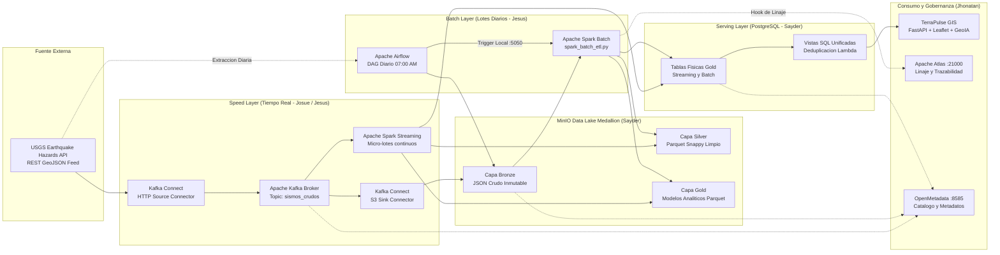

# Sistema Distribuido de Monitoreo Sismico Global

Plataforma de Big Data para monitoreo y analisis geofisico en tiempo real e historico, implementada bajo una **Arquitectura Lambda** integrada con un **Data Lake Medallion (Bronze, Silver, Gold)** sobre MinIO S3, Apache Kafka, Apache Spark, Apache Airflow, PostgreSQL, Apache Atlas, OpenMetadata y una interfaz GIS interactiva en FastAPI con asistente de inteligencia artificial GeoIA.

---

## 1. Resumen Ejecutivo del Proyecto

El sistema captura, almacena, limpia, procesa, agrega y cataloga eventos sismicos a escala global reportados por el Servicio Geologico de los Estados Unidos (USGS Earthquake Hazards Program). La arquitectura desacopla el flujo en dos carriles de computo paralelos y complementarios:

* **Carril de Tiempo Real (Speed Layer):** Ingesta continua segundo a segundo mediante Kafka Connect y Apache Spark Structured Streaming, procesando micro-lotes hacia el Data Lake y actualizando la base de datos operativa en milisegundos para soporte de alertas tempranas.
* **Carril por Lotes (Batch Layer):** Extraccion programada diaria mediante Apache Airflow y procesamiento masivo con Apache Spark Batch, garantizando la reconciliacion historica, la completitud de datos y la reparacion de posibles vacios ocasionados por interrupciones de red.
* **Serving Layer (PostgreSQL):** Vistas SQL unificadas con deduplicacion inteligente que combinan en tiempo de consulta la vision consolidada historica con la telemetria en vivo del dia actual.
* **Gobernanza y Linaje de Datos:** 
  * **Apache Atlas:** Trazabilidad grafica del linaje de datos de extremo a extremo (Data Lineage) a nivel de procesos y transformaciones ETL.
  * **OpenMetadata:** Catalogo unificado de activos de datos, esquemas de tablas, glosario de terminos tecnicos y clasificacion de fuentes.
* **Centro de Mando Web (TerraPulse GIS):** Dashboard cartografico interactivo con deteccion visual de sismos criticos, capas tectonicas, buscador inteligente por pais y asistente conversacional GeoIA impulsado por IA generativa.

---

## 2. Diagrama de Arquitectura de Alto Nivel



---

## 3. Topologia Distribuida del Cluster (4 Laptops)

La arquitectura se encuentra desplegada en **4 computadores fisicos** interconectados mediante red local:

| Laptop / Responsable | Rol Tecnico | Componentes y Servicios Desplegados | Puertos de Red |
| :--- | :--- | :--- | :--- |
| **Sayder** | Servidor de Almacenamiento Central y Base de Datos | - **MinIO S3 Object Storage:** Buckets `bronze`, `silver`, `gold`<br/>- **MinIO Console:** Consola administrativa web<br/>- **PostgreSQL Serving Layer:** Tablas fisicas y vistas SQL | `9000` (MinIO API)<br/>`9001` (MinIO UI)<br/>`5432` (PostgreSQL) |
| **Josue** | Servidor de Ingesta y Mensajeria en Tiempo Real | - **Apache Kafka Broker:** Modo KRaft (sin ZooKeeper)<br/>- **Kafka Connect:** Conector HTTP Source y conector S3 Sink<br/>- **Kafdrop UI:** Monitor de topicos y particiones de Kafka | `9092` (Kafka Broker)<br/>`8083` (Connect REST)<br/>`9009` (Kafdrop UI) |
| **Jesus** | Servidor de Computo Masivo y Orquestacion | - **Apache Airflow:** Scheduler, Webserver y Celery Workers<br/>- **Apache Spark Master:** Coordinador del cluster distribuido<br/>- **Apache Spark Workers:** Nodos de ejecucion de tareas<br/>- **PySpark Streaming Job:** Pipeline de micro-lotes 24/7<br/>- **PySpark Batch ETL:** Pipeline de lotes diarios<br/>- **Spark Trigger HTTP Server:** Endpoint Flask REST interno | `8080` (Airflow Web)<br/>`7077` (Spark Master)<br/>`8085` (Spark UI)<br/>`5050` (Trigger API) |
| **Jhonatan** (Tech Lead) | Servidor de Gobernanza, Linaje y Consumo | - **Apache Atlas:** Plataforma de gobernanza y linaje visual<br/>- **OpenMetadata:** Catalogo centralizado de metadatos<br/>- **TerraPulse GIS Dashboard:** Servidor web FastAPI<br/>- **GeoIA Copilot:** Agente conversacional RAG sobre PostgreSQL | `21000` (Atlas UI & REST)<br/>`8585` (OpenMetadata UI)<br/>`8000` (TerraPulse GIS) |

> **Nota de red:** Airflow y Spark conviven en la misma maquina fisica (computador de Jesus) interconectados a traves de una red interna de Docker (`red_bigdata`). Por esta razon, la orquestacion de Airflow invocando a Spark es 100% local (`spark-master:5050/trigger`), evitando sobrecargar la red Wi-Fi compartida.

---

## 4. Especificacion del Data Lake Medallion (MinIO)

El Data Lake se organiza en 3 niveles progresivos de refinamiento, implementados sobre buckets S3 en MinIO:

### A. Capa Bronze (Datos Crudos e Inmutables)
Almacena el payload GeoJSON original sin transformaciones ni perdida de precision.

* **Carril Streaming:** `s3a://bronze/streaming/ano=YYYY/mes=MM/dia=DD/*.json`
  * Generado 24/7 por Kafka Connect S3 Sink con particionamiento temporal automatico.
* **Carril Batch:** `s3a://bronze/batch/ano=YYYY/mes=MM/dia=DD/sismos_batch_YYYY-MM-DD.json`
  * Descargado diariamente a las 07:00 AM UTC por el DAG programado en Apache Airflow.

### B. Capa Silver (Datos Limpios y Tipados: `fact_sismos`)
Estructura tabular aplanada, tipada estrictamente y deduplicada por `id_evento`. Formato Parquet con compresion Snappy particionado fisicamente por `fecha_evento`.

* **Rutas en MinIO:**
  * Streaming: `s3a://silver/streaming/fecha_evento=YYYY-MM-DD/*.parquet`
  * Batch: `s3a://silver/batch/fecha_evento=YYYY-MM-DD/*.parquet`

| Columna | Tipo Spark | Tipo SQL | Descripcion / Regla de Calidad |
| :--- | :--- | :--- | :--- |
| `id_evento` | `StringType` | `VARCHAR(50)` | Identificador alfanumerico unico emitido por USGS (PK). |
| `fecha_hora_utc` | `TimestampType` | `TIMESTAMP` | Timestamp exacto en UTC (`properties.time / 1000`). |
| `fecha_evento` | `DateType` | `DATE` | Fecha del sismo (Columna de particion fisica). |
| `hora_evento` | `IntegerType` | `INT` | Hora del evento (0 a 23) para analisis temporal. |
| `magnitud` | `DecimalType(4,2)` | `NUMERIC(4,2)` | Magnitud en escala Richter/Momento (`properties.mag`). |
| `tipo_magnitud` | `StringType` | `VARCHAR(10)` | Metodo de calculo (ej. `mww`, `mwr`, `ml`, `mb`). |
| `profundidad_km` | `DecimalType(6,2)` | `NUMERIC(6,2)` | Profundidad del hipocentro en km (`geometry.coordinates[2]`). |
| `latitud` | `DecimalType(7,4)` | `NUMERIC(7,4)` | Latitud geografica WGS84 (`geometry.coordinates[1]`). |
| `longitud` | `DecimalType(7,4)` | `NUMERIC(7,4)` | Longitud geografica WGS84 (`geometry.coordinates[0]`). |
| `zona_referencia` | `StringType` | `VARCHAR(255)` | Descripcion geografica del epicentro (`properties.place`). |
| `pais_region` | `StringType` | `VARCHAR(100)` | Pais o region geografica extraida tras la coma en `place`. |
| `alerta_tsunami` | `IntegerType` | `INT` | 1 si USGS emitio alerta de tsunami; 0 en caso contrario. |
| `nivel_alerta` | `StringType` | `VARCHAR(20)` | `CRITICO` (Mw >= 6.0), `MODERADO` (5.0 <= Mw < 6.0), `LEVE` (< 5.0). |
| `tipo_profundidad` | `StringType` | `VARCHAR(20)` | `SUPERFICIAL` (<= 70 km), `INTERMEDIA` (70-300 km), `PROFUNDA` (> 300 km). |

### C. Capa Gold (Modelos Analiticos de Negocio)
Tablas agregadas optimizadas para consultas analiticas masivas y cuadros de mando.

1. **Modelo Analitico 1 (`resumen_diario_pais`):**
   * Grano: Pais/Region y Fecha.
   * Metricas: `total_sismos`, `sismos_criticos_m6`, `sismos_graves_m5`, `magnitud_maxima`, `profundidad_promedio_km`, `sismos_con_tsunami`.
   * Formato: Parquet particionado por `ano` y `mes`.
2. **Modelo Analitico 2 (`zonas_criticas_frecuentes`):**
   * Grano: Cuadrante geografico de 1 grado x 1 grado (`floor(lat)`, `floor(lon)`).
   * Utilidad: Deteccion de enjambres sismicos y fallas geologicas activas.
   * Metricas: `total_sismos_registrados`, `magnitud_maxima`, `nivel_alerta`, `sismos_graves_m5`.

---

## 5. Serving Layer (PostgreSQL) y Deduplicacion Lambda

La base de datos PostgreSQL en la laptop de Sayder opera como capa de servicio de lectura rapida. Para evitar datos duplicados o inconsistencias entre el carril streaming y el carril batch, se implementan vistas SQL con deduplicacion deterministica:

* **Tablas Fisicas:**
  * `gold_resumen_batch` y `gold_zonas_batch` (Cargadas por Spark Batch diariamente).
  * `delta_streaming_hoy` (Cargada continuamente por Spark Streaming con operacion `upsert`).
* **Vistas SQL Unificadas:**
  * `vista_resumen_diario_pais`: Realiza un `UNION ALL` donde los registros de streaming del dia en curso tienen prioridad (`origen = 'STREAMING'`), mientras que para fechas anteriores prevalece el historico batch consolidado (`origen = 'BATCH'`).
  * `vista_zonas_criticas_frecuentes`: Consolida las frecuencias de eventos por cuadrante geografico para alimentar en tiempo real los marcadores del mapa GIS.

---

## 6. Gobernanza y Linaje de Datos (Apache Atlas & OpenMetadata)

### Apache Atlas (Linaje Grafico de Transformaciones)
Permite visualizar la trazabilidad completa del dato a traves de su API REST v2:
* **Entidades Catalogadas:** `usgs_api_raw` -> `minio_bronze_batch` -> `spark_batch_etl` -> `minio_silver_fact_sismos` -> `minio_gold_resumen` -> `postgres_serving_layer`.
* **Hooks de Notificacion:** El script `atlas_hook.py` notifica el estado de ejecucion, tiempos y linaje a Atlas cada vez que finaliza un proceso ETL en Spark.

### OpenMetadata (Catalogo de Metadatos y Glosario Central)
Provee un portal unificado para la gobernanza del clúster:
* **Servicios Conectados:**
  * Pipeline Kafka (`sismos_crudos`).
  * Almacenamiento MinIO S3 (`bronze`, `silver`, `gold`).
  * Base de datos PostgreSQL (`sismos_db`).
* **Automatizacion:** El contenedor `openmetadata_auto_catalog` registra automaticamente los esquemas, tablas, descripciones y tipos de datos de todo el clúster.

---

## 7. Centro de Mando: TerraPulse GIS

Aplicacion web reactiva desarrollada sobre FastAPI y Leaflet.js:
* **Capas Base Dinamicas:** Alternancia sin API keys entre Gris Tactico ESRI, Batimetria Oceanica, Imagen Satelital y OpenStreetMap.
* **Buscador Inteligente:** Busqueda con normalizacion de acentos, coincidencia fonetica y diccionario geografico de coordenadas para navegacion rapida por pais o falla geologica.
* **Paneles Colapsables:** Tarjetas Bento con metricas tacticas (Profundidad, Hipocentro, Escala de Peligro, Alerta Tsunami) con modo de pantalla limpia para visualizacion cartografica completa.
* **GeoIA Copilot:** Asistente conversacional de inteligencia artificial accesible mediante un boton flotante en forma de globo terraqueo con distintivo de bot, capaz de responder preguntas en lenguaje natural sobre la actividad sismica actual consultando PostgreSQL mediante arquitectura RAG.

---

## 8. Protocolo de Despliegue en 4 Pasos (Alineacion por `.env`)

Todas las direcciones IP del clúster estan completamente desacopladas del codigo y se configuran mediante variables de entorno en archivos `.env`:

### Paso 1: Identificar las 3 IPs de la Red
Al conectar las 4 laptops al Wi-Fi o hotspot, identificar:
* `IP_SAYDER`: Laptop con MinIO y PostgreSQL.
* `IP_JOSUE`: Laptop con Apache Kafka.
* `IP_JHONATAN`: Laptop con Apache Atlas y OpenMetadata.

### Paso 2: Actualizar `.env` en cada Computador
* **Sayder:** No requiere configurar IPs remotas.
* **Josue:** En `infraestructura/kafka/.env` colocar `HOST_IP=<IP_JOSUE>` y `MINIO_ENDPOINT=http://<IP_SAYDER>:9000`.
* **Jesus:** En `infraestructura/spark/.env` colocar las IPs de Sayder, Josue y Jhonatan. En `infraestructura/airflow/.env` colocar la IP de Sayder.
* **Jhonatan:** En `openmetadata/.env` y `web/.env` colocar las IPs de Sayder y Josue.

### Paso 3: Orden de Arranque de Contenedores
1. **Sayder:** `cd infraestructura/minIO && docker compose up -d` y `cd ../postgres && docker compose up -d`
2. **Josue:** `cd infraestructura/kafka && docker compose up -d`
3. **Jesus:** `cd infraestructura/spark && docker compose up -d` y `cd ../airflow && docker compose up -d`
4. **Jhonatan:** `cd infraestructura/gobernanza && docker compose up -d` y `cd openmetadata && docker compose up -d`

### Paso 4: Levantar TerraPulse GIS
En la laptop de Jhonatan:
```bash
cd web
uvicorn app:app --host 0.0.0.0 --port 8000 --reload
```
Acceder al cuadro de mando en `http://localhost:8000`.

---

## 9. Estructura del Repositorio

```text
Proyecto_sismos/
|-- data/                         # Datasets de muestra GeoJSON y pruebas
|-- docs/                         # Especificaciones tecnicas, tablas y guias
|   |-- especificacion_tablas_medallion.md
|   |-- guia_exposicion_equipo.md # Guia completa de sustentacion y estudio
|   |-- presentacion.html         # Diapositivas interactivas para exposicion
|-- infraestructura/
|   |-- airflow/                  # DAGs y orquestacion batch de Jesus
|   |   |-- dags/dag_sismos_batch_usgs.py
|   |   |-- docker-compose.yml
|   |   |-- .env
|   |-- gobernanza/               # Apache Atlas y OpenMetadata (Jhonatan)
|   |   |-- openmetadata/
|   |   |-- docker-compose.yml
|   |-- kafka/                    # Broker y conectores de Josue
|   |   |-- connectors/
|   |   |-- docker-compose.yml
|   |   |-- .env
|   |-- minIO/                    # Data Lake Medallion de Sayder
|   |   |-- docker-compose.yml
|   |-- postgres/                 # Serving Layer y DDL de Sayder
|   |   |-- init-scripts/init.sql
|   |   |-- docker-compose.yml
|   |-- spark/                    # Cómputo masivo y streaming de Jesus
|       |-- apps/spark_batch_etl.py
|       |-- apps/spark_streaming_job.py
|       |-- apps/spark_trigger_server.py
|       |-- apps/atlas_hook.py
|       |-- docker-compose.yml
|       |-- .env
|-- web/                          # Servidor FastAPI y Dashboard GIS (Jhonatan)
    |-- app.py
    |-- database.py
    |-- ai_copilot.py
    |-- .env
    |-- static/index.html
|-- README.md                     # Documentacion maestra de la plataforma
```
